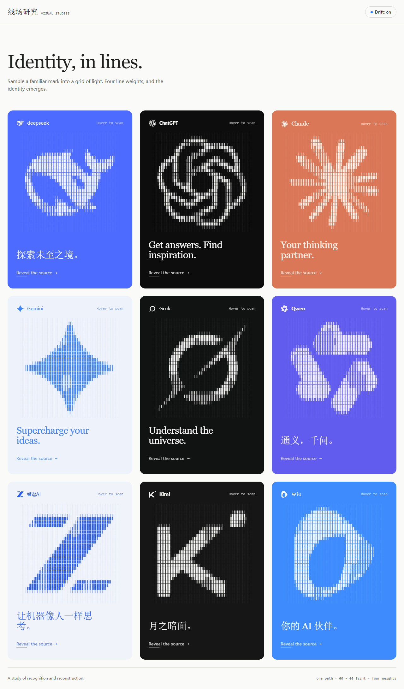

# Identity, in lines.

A generative identity study: nine AI brand marks are sampled into a grid of light, quantized to **four discrete line weights**, and redrawn as a field of vertical strokes. The identity emerges from the field — not from a bitmap.



**Live demo:** https://chenyiming-aaa.github.io/quantized-line-field/

The whole thing is **one self-contained `index.html`** — no libraries, no frameworks, no build step, no network requests, no external fonts. Open the file and it runs.

---

## What you see

- **Nine cards**, one per brand: DeepSeek, ChatGPT, Claude, Gemini, Grok, Qwen, Zhipu GLM, Kimi, Doubao.
- Each card carries its brand's representative color (DeepSeek blue, ChatGPT black/white, Claude terracotta, Gemini blue, Grok black/white, Qwen purple, Zhipu blue, Kimi black/white, Doubao sky blue).
- The mark is rendered **only as vertical lines** in four widths — never a gradient, never an image.
- A slow seeded **drift** animates the field; the pointer parts nearby lines and a damped **spring** returns them to the grid.
- Hover (or keyboard focus) reveals blue **detection boxes** that scan the brightest regions of the live field and label them with grid coordinates.
- Taglines are Chinese for domestic brands and English for international ones; the page chrome follows the reference study's English editorial voice.

## How it works

1. **Path → luminance (sampled once).** Each brand's 24×24 vector path is painted white-on-black into a 300×300 offscreen canvas (60 cells × 5× supersampling). Rec. 709 luminance is averaged per cell into a `60×60` `Float32Array`; the scratch canvas is then released. Pixels are read **once per brand at init**, never again.
2. **Visual size normalization.** The real ink bounding box of every mark is measured, then each mark is scaled and centered to fill a uniform **90%** of the plot area — so all nine read as the same visual size, full but not crowded. The same normalization drives the small corner icon and the source dialog.
3. **Luminance → lines.** 60 columns × 30 segments (each segment averages two grid rows). Three thresholds quantize every segment into exactly four levels:

   | Level | Luminance | Width (× cell/5.25) | Opacity |
   |---|---|---|---|
   | 0 | `< 0.12` | 0.38 | 0.15 |
   | 1 | `0.12 – 0.42` | 1.12 | 0.64 |
   | 2 | `0.42 – 0.89` | 2.28 | 0.93 |
   | 3 | `≥ 0.89` | 3.80 | 1.00 |

   Segments are ~2 cells tall with a 0.7px gap and flat caps, grouped and stroked once per level per frame.
4. **Seeded drift.** One shared 128×128 lattice from an xorshift PRNG (seed `7319`), bilinear value noise, per-brand horizontal offset. The pattern drifts slowly downward; no `Math.random` in the animation loop.
5. **Pointer spring.** A radial impulse (stiffness 145, damping 19, pulse decay `exp(-5.5t)`) displaces nearby segments; they settle back to rest. A stationary pointer never holds the lines apart.
6. **Detection overlay.** A summed-area table scores 7×7 windows over the live displaced field every 100ms, keeps up to three regions with non-maximum suppression, and tracks them with critically damped springs (stiffness 144, damping 24). Boxes snap to integer grid cells; coordinates render to one decimal while moving.

## Core parameters

| Item | Value |
|---|---|
| Luminance grid | 60 × 60 |
| Drawn grid | 60 × 30 |
| Pixel reads | 1 per brand at init, 0 afterwards |
| Stroke weights | 4 (0.38 / 1.12 / 2.28 / 3.80) |
| Thresholds | 0.12 / 0.42 / 0.89 |
| Noise lattice | 128 × 128, xorshift seed 7319 |
| Visual fill | 90% of plot, bbox-normalized |
| Display scale | CSS × devicePixelRatio (resize without resampling) |

## Prompt & design references

This page is an implementation of the **Quantized Line Field** style system. The design language, components, and implementation contract come from StyleKit:

- **Style guide / showcase (primary reference):** https://www.stylekit.top/styles/quantized-line-field/showcase
  The showcase publishes the full generation prompt — *"Create one polished, responsive, self-contained HTML file titled 'Identity, in lines.' … Canvas 2D and Path2D only … four line weights … one-time path sampling … seeded flowing noise … pointer spring … deterministic detection callouts."* This project follows that contract (one-time sampling, four discrete weights, seeded drift, spring return, grid-snapped detection, DPR-aware rendering, reduced-motion support) and extends it from three marks to nine AI brands with per-brand palettes.
- **Layout reference experiment:** https://www.stylekit.top/experiments/brand-line-cards/index.html
  The editorial framing — large serif heading, short intro, a card array, and the two-line annotation footer (*"A study of recognition and reconstruction."* / *"One path. A field of light. Four line weights."*) — is modeled on this experiment.
- **StyleKit:** https://www.stylekit.top

### Design tokens (from the style guide)

- Paper `#fafaf8` · Ink `#202220` · Detection blue `#267dff` · Signal red `#ec353e`
- Cards radius 17px · buttons full-round · inputs 12px · page max 1280px · card padding 28px
- Type: serif display (Georgia / Songti SC fallback), sans UI (system-ui), mono coordinates (ui-monospace) — all local stacks, no webfonts.

## Logo sources & attribution

All nine mark paths are taken from the open-source **[LobeHub Icons](https://github.com/lobehub/lobe-icons)** project (MIT). Original SVGs are kept in [`assets/logos/`](assets/logos/) for provenance:

| Brand | Mark file | Card color | Tagline |
|---|---|---|---|
| DeepSeek | `deepseek.svg` | `#4d6bfe` | 探索未至之境。 |
| ChatGPT | `openai.svg` | `#0d0d0d` | Get answers. Find inspiration. |
| Claude | `claude.svg` | `#d97757` | Your thinking partner. |
| Gemini | `gemini.svg` | `#eef2fa` / blue lines | Supercharge your ideas. |
| Grok | `grok.svg` | `#111212` | Understand the universe. |
| Qwen | `qwen.svg` | `#615ced` | 通义，千问。 |
| Zhipu GLM | `zai.svg` (Z.ai mark) | `#f0f4fa` / blue lines | 让机器像人一样思考。 |
| Kimi | `kimi.svg` | `#161616` | 月之暗面。 |
| Doubao | `doubao.svg` | `#3d8bfd` | 你的 AI 伙伴。 |

> **Trademark notice:** All brand names, logos, and trademarks belong to their respective owners (DeepSeek, OpenAI, Anthropic, Google, xAI, Alibaba, Zhipu AI, Moonshot AI, ByteDance). They are used here solely for a non-commercial generative visual study and do not imply endorsement. Each card's **"Reveal the source"** dialog links back to the original SVG and shows the exact path data.

## Run locally

No server needed — just open `index.html` in a modern browser. If you prefer a local server:

```bash
python -m http.server 8000
# then visit http://localhost:8000
```

## Deploy (GitHub Pages)

This repo is published from the `main` branch root via GitHub Pages (`.nojekyll` disables Jekyll). To redeploy your own fork:

1. Push the repo to GitHub.
2. **Settings → Pages → Build and deployment → Source: Deploy from a branch → `main` / `/ (root)`.**
3. The site goes live at `https://<user>.github.io/<repo>/`.

Or with the GitHub CLI:

```bash
gh repo create quantized-line-field --public --source=. --push
gh api repos/<user>/quantized-line-field/pages -X POST -f source[branch]=main -f source[path]=/
```

## Customize

Everything lives in the `BRANDS` array near the top of the `<script>` in `index.html`. To swap or add a mark, replace its `paths` (24×24 SVG path data), `name`, `tag`, and palette (`bg` / `ink` / `det` / `border`) together. The bounding-box normalization adapts automatically. The global fill ratio is the `F = 0.90` constant in `sampleMark` — raise it for a fuller field, lower it for more breathing room.

## Accessibility & performance

- Honors `prefers-reduced-motion` (starts still; a **Drift** toggle lets anyone pause/resume).
- Cards are keyboard-focusable; focus reveals the detection overlay; visible focus rings use the detection blue.
- Canvas is decorative (`aria-hidden`); cards carry descriptive labels.
- High-DPI aware: backing store = CSS size × DPR, with a `matchMedia` DPR listener; resize never resamples the marks.
- Animation pauses when the tab is hidden, a card is offscreen (`IntersectionObserver`), or the source dialog is open.
- Touch-friendly hit targets (≥ 44px); the source action is a borderless text link whose hairline underline "draws" on hover.

## Browser support

Any modern browser with Canvas 2D + `Path2D` (recent Chrome, Edge, Firefox, Safari). A graceful in-page fallback message appears if either is unavailable.

## Repository structure

```
.
├── index.html          # the entire site — self-contained
├── assets/preview.png  # full-page preview shown above
├── assets/logos/       # original brand SVGs (provenance, LobeHub Icons MIT)
├── README.md
├── LICENSE             # MIT + third-party / trademark notices
└── .nojekyll
```

## License

Code: **MIT** (see [`LICENSE`](LICENSE)). Logo path data: MIT, from LobeHub Icons. Brand marks: property of their respective owners.